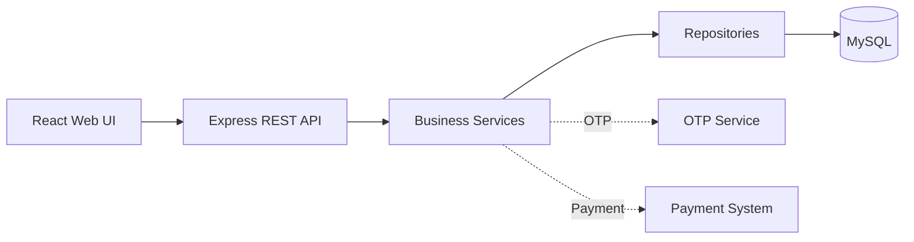

# Kiến trúc hệ thống

Hệ thống áp dụng kiến trúc 3 lớp theo thiết kế Lab 06.

| Lớp | Thành phần | Trách nhiệm |
|---|---|---|
| Trình bày | React pages, components | Nhập liệu, hiển thị kết quả theo vai trò |
| Nghiệp vụ | Controllers, services | Đăng nhập, mở sổ, gửi/rút, tính lãi, báo cáo |
| Dữ liệu | Repositories, MySQL | Truy vấn và bảo đảm tính nhất quán giao dịch |

Skeleton hiện có endpoint `GET /api/health` để kiểm tra ứng dụng và kết nối CSDL. Các mô-đun nghiệp vụ sẽ được bổ sung trong các nhánh `feature/*` tiếp theo.
