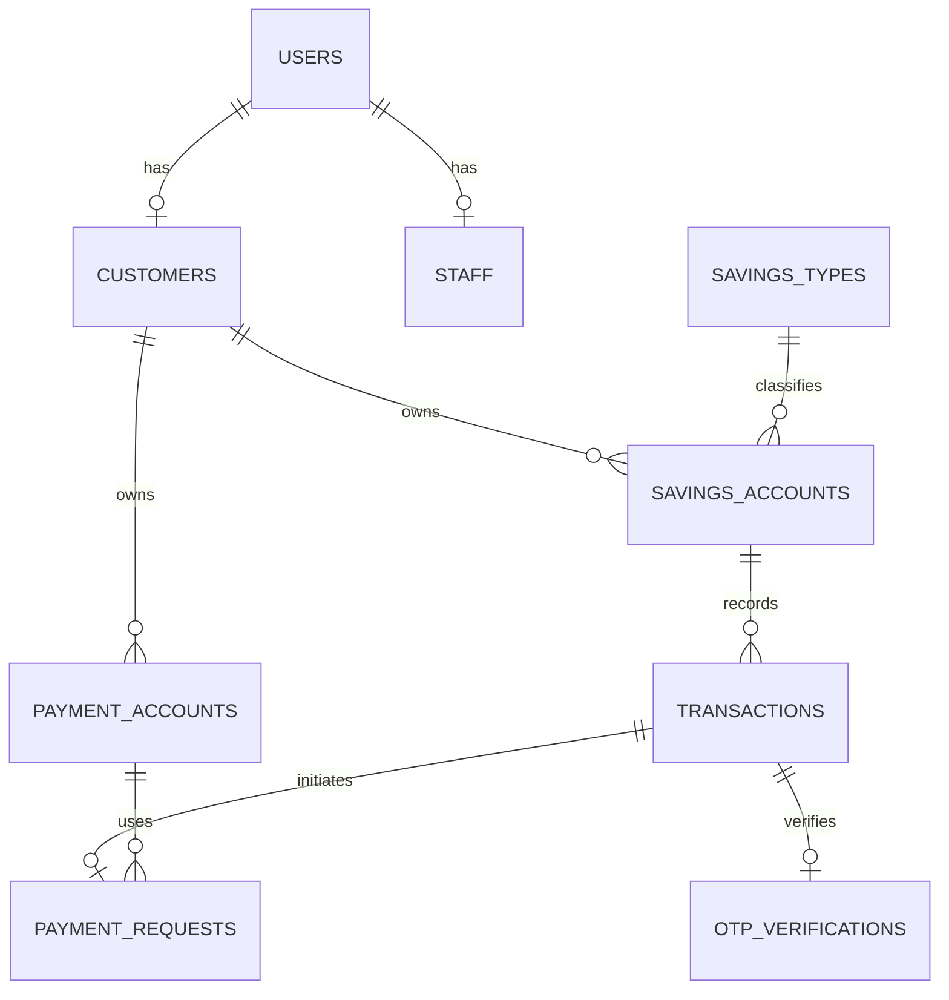

# Thiết kế cơ sở dữ liệu

Thiết kế kế thừa Data Dictionary của Lab 06.

| Nhóm | Bảng |
|---|---|
| Người dùng | `users`, `customers`, `staff`, `login_sessions` |
| Tiết kiệm | `payment_accounts`, `savings_types`, `savings_accounts`, `transactions` |
| Tích hợp/cấu hình | `otp_verifications`, `payment_requests`, `system_parameters` |

Nguyên tắc chính: số tiền dùng `DECIMAL`, OTP chỉ lưu dạng băm, giao dịch tài chính cập nhật trong một database transaction và báo cáo chỉ lấy giao dịch `SUCCESS`.
