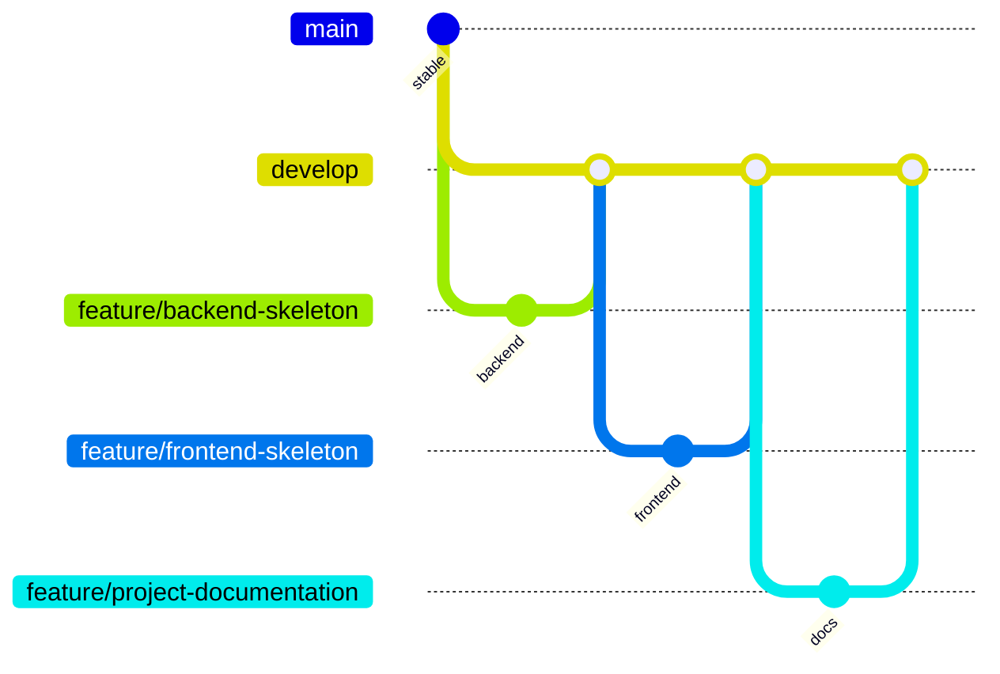

# Git Flow

## Ma trận nhánh và đầu ra

| Nhánh | Phạm vi | Minh chứng |
|---|---|---|
| `main` | Phiên bản ổn định | Lịch sử commit trên GitHub |
| `develop` | Tích hợp skeleton | Các Pull Request đã merge |
| `feature/backend-skeleton` | API, cấu hình MySQL, kiểm thử | `backend/`, kết quả `npm test` |
| `feature/frontend-skeleton` | Login, dashboard, API client | `frontend/`, kết quả `npm run build` |
| `feature/project-documentation` | README và tài liệu thiết kế | `README.md`, `docs/` |

## Quy tắc tích hợp

1. Đồng bộ `develop` trước khi tạo `feature/*`.
2. Commit ngắn gọn, mỗi commit có một mục đích.
3. Push nhánh feature và tạo Pull Request vào `develop`.
4. Review mã nguồn, bảo mật, build/test và tài liệu.
5. Chỉ merge khi phản hồi đã được xử lý.
